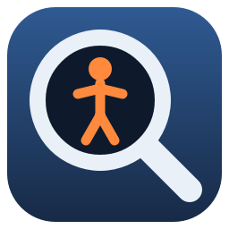
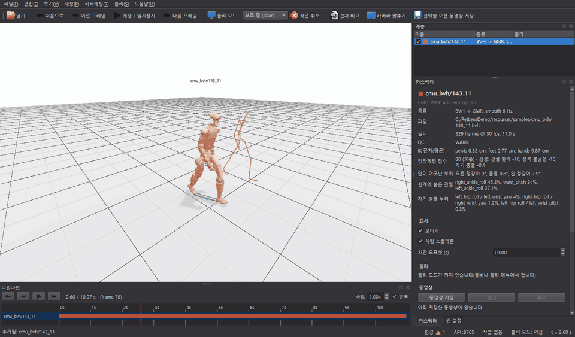
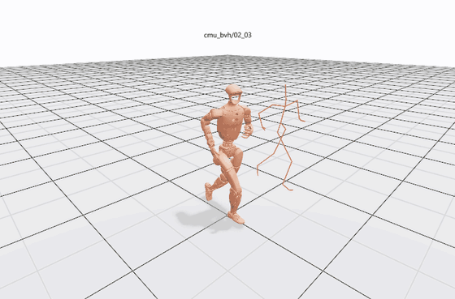

<div align="center">



# RetLens

**사람 모션캡처를 휴머노이드 로봇에 옮겨 보고, 비교하고, 물리로 검증하는 Windows 프로그램**


-orange)


[**⬇ 다운로드 (Releases)**](https://github.com/rlawlsgus/retarget-lens/releases/latest) · [사용 설명서](docs/manual.md) · [CMU 동작 목록](docs/cmu_motion_labels.md)



</div>

## 무엇을 할 수 있나요

<table>
<tr>
<td width="50%" valign="top">

**리타게팅** — BVH·FBX·AMASS SMPL-X 파일을 열면 G1 로봇 동작으로 바로 바꿔 사람 스켈레톤과 나란히 재생합니다.



</td>
<td width="50%" valign="top">

**겹쳐 비교** — 같은 CMU 동작(02_01)을 BVH와 FBX로 각각 리타게팅해 겹친 모습입니다. 기준(A)은 회색 반투명, 대상(B)은 3 cm 넘게 벗어난 부위만 노랑 → 빨강으로 칠합니다.


</td>
</tr>
<tr>
<td valign="top">

**물리 검증** — 로봇이 그 동작을 자기 발로 할 수 있는지 시뮬레이션합니다. 왼쪽은 제어 없이 따라가다 넘어지고, 오른쪽은 추적 정책(GMT)이 균형을 잡습니다.

 

</td>
<td valign="top">

**C3D 마커** — 광학 마커 원본을 같은 촬영의 리타겟 로봇 옆에 그리고, 빠진 마커·튐을 점검합니다.


</td>
</tr>
</table>

**분석** — 관절각·골반 그래프와 지표 표(부드러움, 발 미끄러짐, 바닥 관통, 균형, 리타게팅 점수 0–100, QC 판정)를 모션마다 나란히 봅니다.


## 설치

1. [**Releases**](https://github.com/rlawlsgus/retarget-lens/releases/latest)에서 `RetLens-<버전>-win64.zip`을 받아 원하는 폴더에 풉니다.
2. `RetLens\RetLens.exe`를 실행합니다. "Windows의 PC 보호" 창이 뜨면 **추가 정보 → 실행**을 누릅니다(코드 서명 전이라 뜹니다).
3. 끝입니다. BVH와 로봇 모션은 바로 열립니다(C3D는 같은 이름의 BVH가 옆에 있을 때). 아래 기능만 추가 프로그램이 필요하고, **파일 > 설치 도우미**가 PC를 점검해 필요한 것만 받아 줍니다.

| 기능 | 필요한 것 | 설치 도우미 |
|---|---|---|
| FBX 열기 | Blender 4.5 LTS | 자동 설치 |
| 물리 모드 "추적 정책 (GMT)" | GMT 추적 정책 (연구용) | 라이선스 동의 후 자동 설치 |
| 물리 모드 "보조 힘 (Isaac)", 동영상 저장 | Isaac Sim 6.1, NVIDIA RTX GPU | NVIDIA EULA 동의 후 자동 설치 |
| AMASS SMPL-X 열기 | SMPL-X 모델 (등록 필요) | 사이트에서 받은 zip 가져오기 |


이미 있는 프로그램은 그대로 쓰고, 설치는 필요하고 가능할 때만 합니다. 파일은 각 배포처에서 직접 받고 체크섬을 확인합니다.

## 사용 방법

1. **모션 열기** — 아래 **프로젝트** 패널에서 예제(`samples`)를 두 번 누르거나, 파일을 창에 끌어다 놓거나, `Ctrl+O`로 엽니다. 사람 모션은 처음 열 때 리타게팅에 수십 초가 걸립니다(다음부터는 바로 열림).
2. **재생** — `Space` 재생/일시정지, `←/→` 한 프레임, 타임라인을 끌어 이동합니다. 여러 모션은 같은 시간축에서 함께 재생됩니다. 모션 옆에 라벨 파일(`<이름>.labels.csv`)이 있으면 타임라인 막대 아래에 구간과 라벨이 나옵니다([구간 라벨](docs/manual.md#구간-라벨)). 라벨 파일이 없으면 규칙 파일대로 사람 동작을 보고 붙일 수도 있습니다([자동 라벨](docs/manual.md#자동-라벨)).
3. **살펴보기** — 계층 패널에서 모션을 고르면 **인스펙터**에 파일 정보, QC, 리타게팅 점수와 감점 이유가 나옵니다. **분석** 탭에서 그래프와 지표 표를 봅니다.
4. **비교** — 모션을 두 개 열고 툴바의 **겹쳐 비교**(`O`)를 누릅니다. **비교** 탭에 부위별 차이 그래프와 표가 나옵니다.
5. **물리** — 툴바의 **물리 모드**(`P`)를 켜고 균형 제어(보조 힘 / 없음 / 추적 정책)를 고릅니다. 넘어진 시각은 타임라인에 빨간 표시로 나옵니다.
6. **내보내기** — **선택한 모션 동영상 저장**(`Ctrl+E`)으로 Isaac Sim 녹화 MP4를 만듭니다.

그림의 번호가 위 단계의 번호입니다.


자세한 설명은 [**사용 설명서**](docs/manual.md)에 있습니다.

## 지원 형식

| 형식 | 열면 | 비고 |
|---|---|---|
| BVH | 리타게팅 후 재생 | CMU, Vicon, OptiTrack, Xsens, Rokoko 등 |
| FBX | 리타게팅 후 재생 | MotionBuilder, Shogun, Motive, Mixamo 등. Blender 4.5 필요 |
| AMASS SMPL-X (`.npz`) | 리타게팅 후 재생 | SMPL-X 모델 필요 |
| C3D | 마커 + 같은 촬영의 리타겟 | 같은 이름의 BVH·FBX·AMASS 파일을 찾아 씀 |
| 로봇 모션 (`.npz`, Unitree `.csv`, GMR `.pkl`) | 그대로 재생 | 물리 결과(`*_sim.npz`)도 지표와 함께 열림 |

## AI·스크립트로 쓰기

- **`retlens-cli.exe`** — 창 없이 리타게팅·QC·지표·비교·물리를 돌리고 JSON으로 결과를 냅니다.

  ```powershell
  # RetLens 폴더에서
  .\retlens-cli.exe inspect walk.bvh            # QC, 지표, 리타게팅 점수
  .\retlens-cli.exe compare walk.bvh walk.fbx   # 겹쳐 비교 수치와 가장 다른 순간
  .\retlens-cli.exe setup                       # 설치 도우미 점검 결과
  ```

- **로컬 HTTP API** — 떠 있는 창을 `http://127.0.0.1:8765`에서 조작합니다(이 PC에서만, 토큰 필요).
- **Claude Code 스킬** — 환경 설정의 "Claude Code에 스킬 설치"를 누르면 Claude가 RetLens를 다루는 법을 알게 됩니다.

## 요구 사항

- Windows 10 / 11 64비트, WebGL이 되는 GPU
- 물리 모드 "보조 힘 (Isaac)"과 동영상 저장: NVIDIA RTX GPU(VRAM 8 GB 이상), Isaac Sim 6.1
- 물리 모드 "없음 (MuJoCo)"·"추적 정책 (GMT)"는 Isaac Sim 없이 돌아갑니다.

<details>
<summary><b>소스에서 실행 (개발자)</b></summary>

[Miniconda](https://docs.conda.io/en/latest/miniconda.html)가 필요합니다. `setup_env.ps1`이 conda-forge 환경 `retlens`를 만들고, 로봇 모델이 든 [GMR](https://github.com/YanjieZe/GMR)을 저장소 옆 `..\GMR`에 받습니다.

```powershell
powershell -ExecutionPolicy Bypass -File scripts\setup_env.ps1
conda activate retlens
python tools\editor.py                       # RetLens 창 (scripts\editor.bat도 같음)
python -m pytest tests                       # 테스트
python tools\fetch_samples.py cmu            # 예제 CMU BVH -> data\raw\cmu_bvh
powershell -ExecutionPolicy Bypass -File scripts\build_retlens.ps1 -Samples   # dist\RetLens 빌드
```

CMU C3D 예제는 [mocap.cs.cmu.edu](http://mocap.cs.cmu.edu/)에서 같은 번호의 C3D를 받아 `data\raw\cmu_c3d`에 두면 빌드에 들어갑니다.

</details>

## 라이선스와 고지

- RetLens는 [MIT 라이선스](LICENSE)입니다.
- 함께 들어 있는 것: [GMR](https://github.com/YanjieZe/GMR) 리타게팅 코드(MIT), [Unitree](https://github.com/unitreerobotics) G1 로봇 모델(BSD-3-Clause), GMT의 G1 MuJoCo 모델(Apache-2.0). 고지는 프로그램의 `_internal\licenses`에 있습니다.
- 사용자가 따로 받는 것: Blender(GPL), [GMT](https://github.com/zixuan417/humanoid-general-motion-tracking)(코드 Apache-2.0, 공개 모델은 연구용), Isaac Sim(NVIDIA Omniverse License Agreement), SMPL-X 모델(비상업 라이선스). 각 라이선스는 설치 도우미가 설치 전에 보여 줍니다.
- 예제와 화면의 동작 데이터는 [CMU Graphics Lab Motion Capture Database](http://mocap.cs.cmu.edu/)에서 가져왔습니다. The data used in this project was obtained from mocap.cs.cmu.edu. The database was created with funding from NSF EIA-0196217.
