# RetLens 사용 설명서

RetLens(Retarget Lens)는 사람 모션캡처를 휴머노이드 로봇(Unitree G1, 29 DoF)에 옮겨 보고, 여러 소스를 비교하고, 물리 시뮬레이션으로 검증하는 Windows 프로그램입니다.

- [설치와 첫 실행](#설치와-첫-실행)
- [화면 구성](#화면-구성)
- [모션 열기](#모션-열기)
- [재생과 단축키](#재생과-단축키)
- [분석](#분석)
- [겹쳐 비교](#겹쳐-비교)
- [물리 모드](#물리-모드)
- [C3D 마커](#c3d-마커)
- [동영상 저장](#동영상-저장)
- [환경 설정](#환경-설정)
- [설치 도우미](#설치-도우미)
- [AI·스크립트 연동](#ai스크립트-연동)
- [파일 위치](#파일-위치)
- [문제 해결](#문제-해결)

## 설치와 첫 실행

1. [Releases](https://github.com/rlawlsgus/retarget-lens/releases/latest)에서 `RetLens-<버전>-win64.zip`을 받아 원하는 폴더에 풉니다. 설치 과정은 없고, 폴더째 옮겨도 됩니다.
2. `RetLens\RetLens.exe`를 실행합니다. "Windows의 PC 보호" 창이 뜨면 **추가 정보 → 실행**을 누릅니다.
3. 처음 실행할 때 빠진 프로그램이 있으면 [환경 설정](#환경-설정)이 열립니다. 바로 쓰지 않을 기능이면 닫아도 됩니다. 그 기능만 쓸 수 없고 나머지는 그대로 동작합니다.

같은 폴더의 `retlens-cli.exe`는 창 없이 쓰는 명령줄 도구입니다([AI·스크립트 연동](#ai스크립트-연동)).

## 화면 구성

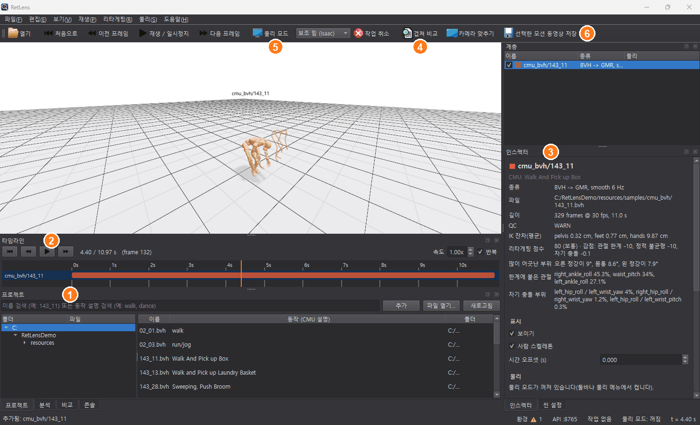

그림의 번호: ① 프로젝트 패널, ② 타임라인, ③ 인스펙터, ④ 겹쳐 비교, ⑤ 물리 모드, ⑥ 동영상 저장.

| 영역 | 내용 |
|---|---|
| 씬 뷰 (가운데) | 3D 장면. 로봇과 사람 스켈레톤, 바닥의 균형 표시(지지다각형·CoM·ZMP). 마우스로 돌리고(왼쪽), 옮기고(오른쪽), 확대(휠)합니다 |
| 계층 (오른쪽 위) | 불러온 모션 목록. 체크로 보이기·숨기기, 우클릭으로 동영상 저장·파일 위치 열기·제거 |
| 인스펙터 (오른쪽) | 고른 모션의 정보: 종류, 파일, 길이, QC, 리타게팅 점수와 감점 이유, 표시 설정, 물리 결과, 동영상, 지표 |
| 씬 설정 (인스펙터 옆 탭) | 배치(나란히 / 겹쳐서)와 간격, 사람 스켈레톤 표시, 로봇 반투명, 이름표, 지금 구간 라벨, 균형 표시 |
| 타임라인 (아래) | 재생 버튼과 모션별 트랙. 라벨 파일이 있는 모션은 막대 아래에 라벨 구간([구간 라벨](#구간-라벨)). 넘어진 시각은 빨간 표시 |
| 프로젝트 · 분석 · 비교 · 콘솔 (아래 탭) | 모션 폴더 탐색, 그래프와 지표 표, 겹쳐 비교 결과, 로그 |
| 상태바 | 진행 중인 작업, 물리 모드 요약, 환경 점검(✓ / ⚠), AI용 로컬 API(API :8765 / 꺼짐), 현재 시각 |

- 패널은 끌어서 옮기거나, 탭으로 합치거나, 떼어 띄우거나, 닫을 수 있습니다. 배치는 다음 실행 때 그대로 열리고, **보기 > 레이아웃 초기화**로 기본 배치로 돌아옵니다.
- 기본은 어두운 테마입니다.

## 모션 열기

- **프로젝트 패널:** 모션 폴더를 트리로 보여 줍니다. 파일을 두 번 누르거나 "추가"를 누릅니다. CMU 파일은 옆에 동작 설명(예: 143_11 → Walk And Pick up Box)이 나오고, 검색 칸은 번호와 설명(예: `dance`)을 모두 찾습니다. 어떤 번호가 무슨 동작인지는 [CMU 동작 목록](cmu_motion_labels.md)에 있습니다.
- **파일 > 열기**(`Ctrl+O`)로 PC의 아무 폴더에서 열거나, 탐색기에서 파일을 창에 끌어다 놓습니다.
- 예제로 CMU 동작 몇 개(BVH, C3D)가 `samples` 폴더에 들어 있습니다.

| 형식 | 열면 | 필요한 것 |
|---|---|---|
| BVH | 리타게팅해서 사람 스켈레톤과 함께 재생 | - |
| FBX | 같음 | Blender 4.5 ([설치 도우미](#설치-도우미)) |
| AMASS SMPL-X `.npz` | 같음 | SMPL-X 모델 ([설치 도우미](#설치-도우미)) |
| C3D | 마커 + 같은 촬영의 리타겟 로봇 ([C3D 마커](#c3d-마커)) | 같은 이름의 BVH·FBX·AMASS 파일 |
| 로봇 모션 `.npz`, Unitree `.csv`, GMR `.pkl` | 그대로 재생 | - |
| 물리 결과 `*_sim.npz` | 시뮬레이션된 동작 + 물리 지표 | - |

- 사람 모션은 처음 열 때 리타게팅에 수십 초가 걸립니다. 그동안에도 화면은 멈추지 않고, 결과를 저장해 두므로 다음부터는 바로 열립니다.
- `.pkl`은 pickle 형식이라 직접 만든 파일만 여세요.

### 리타게팅과 보정

리타게팅은 GMR(General Motion Retargeting)의 IK로 사람 관절 방향과 발 위치를 로봇 관절각으로 풀고, 6 Hz 저역통과로 프레임 사이 떨림을 없앱니다. 사람 키는 클립마다 로봇 크기에 맞춥니다. BVH·FBX·SMPL-X는 로봇 발이 언제 평평한지를 기준 자세(T-pose)가 아니라 클립에서 사람이 딛고 선 자세로 정하므로, T-pose의 발이 기울어 생기던 발끝 들림이 대부분 사라집니다. 클립 안에서 자세에 따라 남는 기울기(CMU 143번 등)는 아래 디딤발 평평 보정으로 고칩니다.

**리타게팅** 메뉴에서 리타게팅 뒤에 거는 보정 세 가지를 켭니다(기본 끔).

- **디딤발 평평 보정:** 서 있는 발의 발바닥을 바닥에 평평하게 붙입니다. 발끝이 들린 채 뒤꿈치로만 서는 리타겟(CMU 143번 피험자 등)용입니다. 두 다리와 골반 높이로 맞추므로 뒤꿈치가 뜨지 않고, 한쪽 발이 떠 있으면 내려 줍니다. 그만큼 골반이 1–3 cm 내려갈 수 있습니다.
- **스윙 발 보정 (2 cm):** 바닥을 스치며 내딛는 발을 2 cm 이상 띄웁니다. 물리 모드에서 발끝이 걸려 넘어지는 것을 줄입니다.
- **자기 관통 보정:** 서로 파고든 로봇 부위를 떼어 놓습니다. 대부분 손·손목이 같은 쪽 엉덩이(고관절 덮개)에 들어간 경우라, 그 팔의 어깨·팔꿈치를 조금 움직입니다. 다리끼리 닿으면 서 있지 않은 다리의 고관절만 움직이고, 골반·허리·디딤 다리는 그대로입니다. 두 발로 선 채 무릎끼리 닿는 경우는 남습니다. 물리 모드(Isaac)는 로봇 부위끼리의 충돌을 계산하지 않아 파고든 손·다리가 서로 통과해 보이는데, 이 보정을 켜면 그런 장면이 줄어듭니다.
- 보정은 **다음에 여는 모션부터** 적용됩니다. 그래서 같은 파일을 보정을 켜고 한 번 더 열면 보정 전후를 나란히 볼 수 있습니다. 모션의 "종류"에 `foot-flat`, `swing >= 2 cm`, `self-collision`처럼 어떻게 만들었는지 붙습니다.

## 재생과 단축키

여러 모션은 같은 시간축에서 함께 재생됩니다. 인스펙터의 "시간 오프셋"으로 모션마다 시작을 옮기거나, 분석 탭의 **기준에 시간 자동 정렬**로 다리 관절각이 가장 잘 맞는 오프셋을 찾습니다.

| 동작 | 단축키 |
|---|---|
| 열기 | `Ctrl+O` |
| 재생 / 일시정지 | `Space` |
| 처음으로 | `Home` |
| 한 프레임 앞 / 뒤 | `→` / `←` |
| 물리 모드 | `P` |
| 겹쳐 비교 | `O` |
| 카메라 맞추기 | `F` |
| 동영상 저장 | `Ctrl+E` |
| 고른 모션 제거 | `Delete` |
| 환경 설정 | `Ctrl+,` |

### 구간 라벨

모션을 구간으로 나눠 이름을 붙인 라벨 파일(동작·subtask 라벨러의 결과, 손으로 쓴 표 등)이 있으면 타임라인의 그 모션 막대 아래에 구간이 나옵니다. 라벨은 있어도 되고 없어도 됩니다. 없는 모션은 지금처럼 막대 하나만 보입니다.

- **어떻게 붙나:** 모션을 열 때 같은 폴더에서 아래 이름을 차례로 찾아 처음 것을 씁니다.
  - `<이름>.labels.csv`, `<이름>.labels.json`, `<이름>_labels.csv`, `<이름>_labels.json`, `<이름>_subtask.csv` (예: `02_01.bvh` → `02_01.labels.csv`)
  - 폴더의 `labels.csv` / `labels.json`: 여러 모션의 표. `seq` 열이 이 모션 파일 이름(확장자 뺀)과 같은 행만 씁니다. 이름이 같은 것이 없으면 같은 촬영으로 봅니다(`02_01_stageii.npz` = `02_01.bvh`). 이 표에는 `seq` 열이 꼭 있어야 합니다.
  - C3D 모션은 같은 촬영의 솔버 결과(BVH·FBX·AMASS) 옆의 라벨 파일과 그 폴더의 표도 찾습니다.
  - 다른 이름의 파일은 인스펙터 **라벨 > 불러오기**, 타임라인·계층 패널 우클릭 **라벨 불러오기**, 또는 파일을 창에 끌어다 놓아 붙입니다.
  - 끌어다 놓으면 이름이 같은 모션(`02_01.labels.csv` → `02_01`)에 붙습니다. 이름이 맞는 모션이 없을 때, 모션 파일 하나와 함께 놓았으면 그 모션에, 라벨 파일만 놓았으면 고른 모션에 붙습니다.
  - 한 모션에는 라벨 파일 하나만 붙습니다. 그 모션의 라벨 파일을 여러 개 함께 놓으면, 열 때 찾는 순서대로 첫 파일을 붙이고 상태바에 알립니다.
  - 폴더의 `labels.csv` / `labels.json`이 라벨 표가 아니면(`label`·`seq`·시간 열이 하나도 없으면) 다른 프로그램의 파일로 보고 건너뜁니다.
- **보이는 것:**
  - 라벨마다 색이 정해져, 같은 라벨은 어느 모션에서나 같은 색입니다. 칸이 넉넉하면 라벨 이름이 칸 안에 쓰이고, 재생 위치가 지나는 구간은 테두리가 진해집니다.
  - 트랙(`track` 열: 예를 들어 이동 / 왼손 / 오른손)이 여러 개면 트랙마다 한 줄씩 그립니다.
  - 라벨이 없는 시간은 빈칸으로 남습니다.
  - 구간에 마우스를 올리면 라벨, 시작·끝 시각과 프레임, 트랙이 나오고, 두 번 누르면 그 구간 처음으로 갑니다.
  - 재생 버튼 옆에는 고른 모션의 지금 라벨이 나옵니다.
  - 3D 뷰에서는 재생 중인 구간의 라벨이 로봇 이름표 바로 아래에 뜹니다. 트랙이 여러 개면 `이동: 걷기`, `왼손: 뻗기`처럼 트랙마다 한 줄씩 씁니다(재생 버튼 옆에는 한 줄로 이어서). 겹쳐 비교 중인 B는 이름표 안에 함께 씁니다. 라벨이 없는 시간, 모션이 아직 시작하지 않았거나 끝난 시간, 숨긴 모션에는 뜨지 않습니다. **씬 설정 > 지금 구간 라벨**로 끕니다.
- **인스펙터 > 라벨:** 어느 파일에서 왔는지, 구간 수와 트랙, 구간 목록(누르면 그 구간 처음으로)이 나옵니다. **빼기**는 화면에서만 뺍니다. 라벨 파일은 RetLens가 바꾸거나 지우지 않습니다.
- **다시 읽기:** 파일을 고친 뒤 누릅니다.
  - 모션 옆에서 찾은 라벨이면 열 때처럼 다시 찾습니다. 그래서 오류 안내대로 파일 이름을 바꾸거나 표에 `seq` 열을 넣은 뒤 누르면 바로 붙습니다.
  - 직접 고른 파일이면 그 파일을 다시 읽습니다.
- **문제가 있을 때:**
  - 쓸 수 없는 라벨 파일이어도 모션은 열립니다. 열이 없거나, 읽을 수 없거나, 폴더 표에 `seq` 열이 없거나, 고른 파일의 `seq`가 다른 모션인 경우입니다. 타임라인 이름 앞에 ⚠가 붙고, 인스펙터에 이유가 나옵니다.
  - 다음은 빼거나 잘라서 그리고 인스펙터에 적습니다: 빈 행, 잘못된 시간의 행, 0초 전이나 모션 길이를 넘는 구간, 같은 트랙에서 겹치는 구간.
  - 값이 열 이름보다 많은 행은 넘친 값을 마지막 열에 이어 붙입니다(마지막 열이 `note`·`name`·`object`일 때). 그 밖이면 버리고 인스펙터에 적습니다. 끝에 붙은 쉼표나, 메모에 따옴표 없이 들어간 쉼표가 이런 행을 만듭니다.
  - 라벨 트랙이 많아 타임라인이 길어지면 3D 뷰를 줄이지 않고 타임라인 안에서 스크롤됩니다. 시간 눈금은 스크롤해도 위에 남습니다.

**CSV 형식** (한 행이 한 구간, 첫 줄은 열 이름, UTF-8 또는 엑셀의 CP949):

| 열 | 뜻 |
|---|---|
| `label` | 구간 라벨 (필수) |
| `start_s`, `end_s` | 모션 첫 프레임부터 초. 끝은 그 시각 직전까지 |
| `start_frame`, `end_frame` | 초 대신 프레임. 끝 프레임까지 포함. `fps` 열이 있으면 그 fps, 없으면 RetLens에 보이는 모션의 fps(리타게팅한 사람 모션은 보통 30). 원본 파일(예: 120 fps BVH)의 프레임 번호면 `fps` 열을 넣으세요 |
| `track` (또는 `axis`) | 선택. 트랙 이름 |
| `name`, `object`, `note` | 선택. 마우스를 올리면 함께 보임 |
| `color` | 선택. `#rrggbb` |
| `seq` | 여러 모션을 담은 표에서 그 행의 모션 파일(예: `CMU/02/02_01_stageii.npz`). 폴더의 `labels.csv`에는 필수. 한 모션의 파일이면 선택이지만, 다른 모션 이름이 들어 있으면 붙지 않습니다 |

```csv
label,name,start_s,end_s
idle,대기,0.0,1.0
reach,손 뻗기,1.0,2.2
carry,옮기기,2.2,5.0
```

JSON은 `{"fps": 30, "segments": [{"label": "reach", "start_s": 1.0, "end_s": 2.2, "track": "왼손"}, ...]}`처럼 씁니다.

### 자동 라벨

라벨 파일이 없어도, **규칙 파일**대로 사람 동작을 보고 구간 라벨을 붙입니다. RetLens는 몸이 무엇을 하는지(걷는 중, 손을 뻗는 중, 양손으로 드는 중 등)만 찾습니다. 그것을 어떤 라벨로 부를지는 규칙 파일이 정합니다. 그래서 프로젝트의 라벨 정의는 이 저장소 밖에 둔 자기 규칙 파일에만 있으면 됩니다. 예시 규칙은 `configs/label_rules_example.yaml`에 있습니다.

- **붙이기:**
  - 인스펙터 **라벨 > 자동 라벨**을 누릅니다. 규칙 파일을 아직 고르지 않았으면 먼저 고르게 합니다.
  - 타임라인·계층 패널 우클릭 메뉴의 **자동 라벨 붙이기**나 **열린 모션 모두 자동 라벨**로도 붙입니다.
- **규칙 파일 바꾸기:**
  - **규칙 파일...**로 다른 파일을 고릅니다. 고른 파일은 설정 파일(`label_rules`)에 남고, 비어 있으면 환경변수 `RETLENS_LABEL_RULES`를 씁니다.
  - 예시 규칙은 설치한 프로그램 폴더의 `_internal\configs\label_rules_example.yaml`에 있습니다(소스에서는 `configs/label_rules_example.yaml`). 파일 고르기 창 제목에도 그 위치가 나옵니다.
  - 프로젝트의 규칙 파일은 이 저장소 밖(예: 문서 폴더)에 두세요. 저장소 안에 두더라도 `configs/`의 다른 `label_rules*` 파일과 `*.rules.yaml`·`*.rules.yml`·`*.rules.json`, `*_subtask.yaml`·`*_subtask.yml`·`*_subtask.json`은 git이 무시합니다.
- **다시 적용:** 규칙 파일을 고친 뒤 **다시 읽기**를 누르면 다시 붙습니다.
- **계산:** 창이 멈추지 않도록 뒤에서 계산합니다(AMASS나 C3D의 솔버 결과는 처음 읽는 데 1–2초). 계산하는 동안 그 모션의 라벨을 다시 바꾸면 나중 것이 남습니다.
- **보관:** **CSV로 저장...**으로 라벨 파일을 남깁니다. 시각은 반올림 없이 써서 다시 열어도 구간 경계가 그대로입니다. 모션 옆에 `<이름>.labels.csv`로 두면 다음에 열 때 바로 붙습니다.
- **되는 모션:** BVH, FBX, AMASS SMPL-X, 그리고 같은 촬영의 골격이 옆에 있는 C3D입니다. 사람 골격이 없는 로봇 모션에는 버튼이 꺼져 있습니다. 발끝 관절이 없는 골격(CMU FBX의 Daz/Poser 골격 등)은 발목 앞쪽에 발끝을 추정해 쓰고 `notes`에 적습니다.
- **트레드밀:** 골반이 2초 넘게 제자리에 있는데 발이 같은 방향으로 계속 밀려나는 구간만 트레드밀로 보고, 그 구간을 `notes`에 적습니다.
- **붙이지 못할 때:** 규칙 파일이 없거나 깨졌거나 모션이 너무 짧으면, 이유를 알리고 모션의 라벨은 그대로 둡니다. **열린 모션 모두 자동 라벨**은 규칙 파일을 먼저 검사해서, 깨졌으면 아무 모션도 바꾸지 않습니다.
- **체형:**
  - AMASS SMPL-X는 몸 모델과 betas로 키, 발목 높이 같은 체형을 계산합니다.
  - BVH·FBX는 몸 모델이 없어 뼈 길이로 추정합니다(Winter 2009 신체 비율). 이런 골격은 관절 위치(골반, 가슴, 어깨)가 SMPL-X와 조금 달라서, 같은 촬영이어도 라벨이 조금 다를 수 있습니다. 특히 허리를 20° 안팎으로 굽힌 자세가 그렇습니다.
- **바닥:** 계단이나 단 위에 올라서면 그 높이를 새 바닥으로 삼아, 골반·무릎·손 높이를 그 발이 딛은 곳에서 잽니다.
- **아직 약한 곳:**
  - 팔을 늘어뜨린 채 두 손으로 든 물건(예: 빗자루)은 들기로 잡지 못할 수 있습니다.
  - 짧은 달리기 끝의 감속은 걷기로 나올 수 있습니다.
  - 사다리 오르기는 값이 없어 발 옮기기로 나옵니다.
- **명령줄:** `retlens-cli autolabel 파일... --rules 규칙.yaml --out 폴더`는 리타게팅 없이 라벨만 붙입니다.
  - `--out`이면 라벨을 붙인 모션마다 그 폴더 안에 `<이름>.labels.csv`를 씁니다. 구간이 하나도 없으면 열 이름만 있는 파일입니다.
  - 이름이 같은 모션은 원래 폴더 구조를 그 아래에 둡니다(다른 드라이브·네트워크 공유는 드라이브 이름부터). 같은 폴더의 `X.c3d`와 `X.bvh`는 `c3d\X.labels.csv`, `bvh\X.labels.csv`가 됩니다. 어느 경우에도 `--out` 밖이나 모션 옆에는 쓰지 않습니다.
  - 라벨을 붙이지 못한 모션은 CSV를 쓰지 않고, 그 자리에 지난 실행의 CSV가 있으면 지웁니다(`csv_removed`).
  - 종료 코드는 0이 모두 성공, 1이 모두 실패, 2가 일부 실패입니다.

**규칙 파일** (YAML 또는 JSON). 레인마다 규칙을 위에서부터 보고, 처음 맞는 규칙이 그 프레임의 라벨이 됩니다.

```yaml
name: 우리 라벨
tracks:
  - track: 동작                  # 타임라인의 레인 이름
    min_seg: 0.3                 # 선택: 이보다 짧은 조각은 더 긴 이웃에 합침
    rules:
      - {label: 걷기, when: {이동: [걷기, 계단 오르기, 계단 내리기]}}
      - {label: 손 뻗기, when: [{왼손: 뻗기}, {오른손: 뻗기}]}
      - {label: 손 뻗기, when: {자세전환: 낮추기}, then: {손: [뻗기, 작업]}, within: 0.5}
      - {label: 서 있기}         # when이 없으면 남은 모든 프레임 (없으면 빈칸으로 남음)
  - {track: 이동, axis: 이동, skip: [정지]}   # 찾은 트랙을 그대로 보이는 레인
```

| 항목 | 뜻 |
|---|---|
| `when` | `{트랙: 값 또는 [값들]}`. 적은 트랙이 모두 맞으면 참. 이런 표의 목록이면 하나라도 맞을 때 참 |
| `then`, `within` | `when`이 참인 구간마다, 그 시작부터 끝난 뒤 `within`초 안에 `then`이 한 번이라도 참이면 그 구간 전체에 붙음 (예: 몸을 낮춘 뒤 손을 뻗는 경우) |
| `name`, `color` | 선택. 라벨의 긴 이름, `#rrggbb`. 같은 라벨을 쓰는 규칙이 여럿이면(다른 레인, `axis` 레인 포함) 처음 준 값 |
| `min_seg` | 선택(초). 라벨이 붙은 구간 안에서 이보다 짧은 조각을 더 긴 이웃 라벨에 합침. 라벨 없는 빈칸은 합치지도 채우지도 않음 |
| `axis`, `skip` | 규칙 대신 찾은 트랙 하나를 그대로 보임. `skip`의 값은 빈칸 |
| `approach` | 선택: `{from: [라벨], to: [라벨], steps: 2, label: 접근}`. from 구간이 to 구간으로 이어지면 from의 마지막 걸음들을 접근으로 바꿈 |
| `params` | 선택: 동작을 찾는 기준값 바꾸기 (`retlens/autolabel/segment.py`의 `DEFAULTS`, 값마다 출처가 주석으로 있음) |

트랙과 값의 이름이 틀리면 붙이지 않고 무엇이 틀렸는지 알려 줍니다. 다음도 오류입니다.
- 한 표에 같은 항목을 두 번 쓴 것: 나중 것이 앞의 것을 조용히 지우게 됩니다.
- `tracks`가 있는데 맨 위에 `min_seg`·`approach` 같은 레인 항목을 쓴 것: 어느 레인에도 적용되지 않습니다.
- 100000을 넘는 시간이나 걸음 수.

형식 오류는 줄과 열, 오류 종류만 알리고 파일 내용은 보이지 않습니다(규칙 파일은 비공개일 수 있음).

쓸 수 있는 트랙과 값은 아래와 같습니다.

| 트랙 | 값 |
|---|---|
| `이동` | 정지, 발 옮기기(제자리 걸음, 무릎 높이 들기 포함), 걷기, 계단 오르기·내리기(10 cm 넘게 높거나 낮은 곳으로 딛음), 달리기(두 발이 2프레임 넘게 떠 있거나 약 2.1 m/s보다 빠른 걸음), 점프(두 발이 떠 있고 골반이 자유 낙하), 제자리 회전, 매달림(두 발이 15 cm 넘게 떠 있고 두 팔이 머리 위, 골반이 선 높이 이상인 채 1초 넘게) |
| `회전` | 방향 전환, 없음 |
| `자세` | 선 자세, 허리 굽힘(20°, 3° 여유를 두고 바뀜), 쪼그림, 앉음(높은 스툴처럼 발이 떠 있거나 골반이 발 뒤에 있는 채로 앉은 것 포함), 무릎 꿇기, 네발 자세(골반이 무릎보다 충분히 높을 때), 누움, 거꾸로, 그리고 그 사이 전환(`선 자세→앉음` 꼴) |
| `자세전환` | 앉기, 일어서기(앉음·누움·네발 자세·거꾸로에서 일어날 때만), 낮추기, 높이기(쪼그림·무릎 꿇기에서 일어서는 것 포함), 없음 |
| `왼손`, `오른손` | 휴지(내림), 뻗기(내미는 중), 작업(위팔이 몸통에서 45° 이상, 또는 손이 무릎 아래이면서 골반보다 키의 10% 넘게 낮은 채), 되돌리기(거두는 중) |
| `손` | 두 손을 합친 것: 뻗기 > 되돌리기 > 작업 > 휴지 순 |
| `양손` | 들기(두 손이 몸 앞에 나란히, 무릎~어깨 높이, 물체 폭 이상 벌어진 채 간격이 일정하고, 아래팔이 앞을 향하며 손이 허벅지에 얹혀 있지 않음), 없음 |
| `걸음` | 걸음 중(발을 떼서 이어지는 걸음의 마지막 디딤까지), 없음 |

## 분석

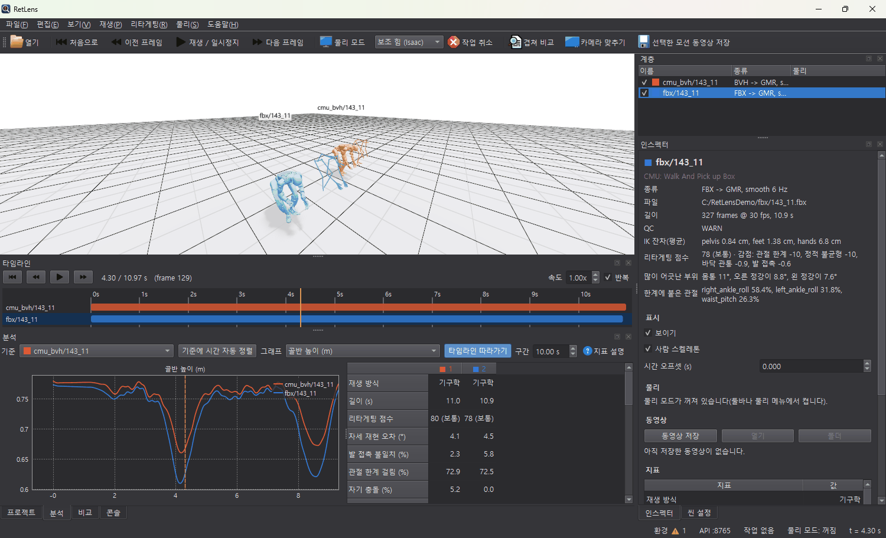

**분석** 탭에는 관절각·골반 높이·골반 수평 속도 그래프와 모션별 지표 표(기준 모션 대비 다리·전체 RMSE 포함)가 나옵니다. 위쪽 "기준"에서 기준 모션을 고릅니다.

- 그래프는 "타임라인 따라가기"(기본 켬)가 눌려 있으면 재생 위치를 가운데에 두고 따라갑니다. 끌어서 옮기고 휠로 확대하면 따라가기가 꺼지고, 두 번 누르면 다시 따라갑니다.
- 지표 표의 행 이름에 마우스를 올리면 그 지표의 설명이 나오고, 위쪽 **지표 설명**(?)에는 모든 지표가 주제별로 정리되어 있습니다.
- 주요 지표: 관절 가속도·저크·최대 속도(부드러움), 발 미끄러짐, 바닥 관통, 발 최저점, 스윙 발 바닥 근접, CoM·ZMP가 지지다각형 밖에 있는 비율, 정적 불균형, 기준 대비 다리·전체 RMSE, QC 판정, 리타게팅 점수. 물리 모드에서는 넘어짐·보조 힘·토크 한계 초과·몸 위치 오차도 나옵니다.
- **씬 설정 > 균형 표시**(기본 켬): 바닥에 지지다각형(초록 선), CoM 투영(파랑), ZMP(빨강)를 그립니다.
- **스윙 발 바닥 근접**은 움직이는 발이 바닥 1 cm 안을 지나는 비율입니다. 기구학 지표지만, 높으면 물리 모드에서 발끝이 걸려 비틀거립니다. 리타게팅 > 스윙 발 보정으로 고칩니다.

### 리타게팅 품질 점수

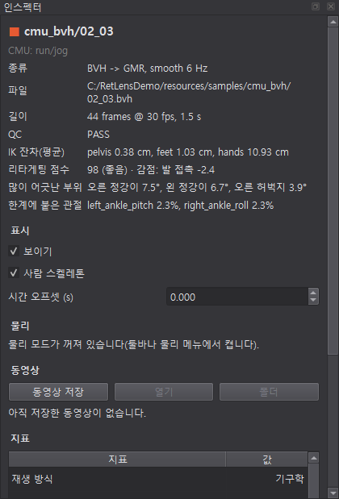

사람 모션을 리타게팅해서 열면 **로봇이 사람 동작을 얼마나 잘 옮겨 받았는지**를 0–100점으로 냅니다. 길이가 아닌 방향, 각자의 다리 길이 같은 로봇 크기와 상관없는 기준이라, 같은 클립을 다른 로봇이나 다른 설정으로 리타게팅한 결과와도 비교할 수 있습니다.

| 지표 | 재는 것 | 감점 시작 | 감점이 다 차는 값 | 최대 감점 |
|---|---|---|---|---|
| 자세 재현 오차 | 허벅지·정강이·위팔·아래팔·몸통이 사람과 다른 방향을 가리키는 각도의 평균 | 8° | 25° | 30 |
| 발 접촉 불일치 | 사람과 로봇 중 한쪽 발만 바닥에 닿은 프레임 비율 | 5% | 30% | 20 |
| 자기 충돌 | 로봇 몸끼리 3 cm 넘게 파고든 프레임 비율 | 5% | 50% | 15 |
| 관절 한계 걸림 | 어느 관절이든 가동 범위 끝 1° 안에 붙은 프레임 비율 | 5% | 50% | 10 |
| 발 미끄러짐 | 디딘 발이 미끄러진 프레임 비율 | 1% | 10% | 10 |
| 정적 불균형 | 멈춰 선 채 CoM이 발 밖에 있는 비율 | 2% | 20% | 10 |
| 바닥 관통 | 발이 바닥을 뚫은 프레임 비율 | 0% | 10% | 5 |

- 85점 이상은 **좋음**, 70점 이상은 **보통**, 그 밖은 **나쁨**입니다. 깨끗한 CMU 걷기·조깅은 90–100점입니다.
- 인스펙터에는 무엇이 점수를 깎았는지, 많이 어긋난 부위, 한계에 붙은 관절, 충돌한 부위가 나옵니다.
- 로봇 모션 파일만 열면 비교할 사람이 없어 점수를 내지 않습니다. 물리 모드에서도 이 행들은 리타게팅 결과 값입니다.

### 검증(QC) 기준

QC는 리타게팅된 로봇 동작을 프레임마다 검사해, 그 동작을 로봇에 쓸 수 있는지 PASS / WARN / FAIL로 판정합니다.

| 플래그 | 의미 |
|---|---|
| 결측 | 값이 없는(NaN) 프레임 |
| 관절 한계 / 속도 | 관절 가동 범위(0.01 rad 허용)나 속도 한계를 넘음 |
| 넘어짐 | 몸통 기울기 75° 초과 또는 골반 높이 0.25 m 미만 |
| 정적 불균형 (soft) | 거의 멈춘 채(CoM 0.1 m/s 미만) CoM이 지지다각형 밖 2 cm 넘게 0.2초 이상 |

- **판정:** 플래그가 붙은 프레임이 2% 이하면 **PASS**, 10% 이하면 **WARN**, 그보다 많으면 **FAIL**입니다. 1초보다 짧은 클립은 FAIL입니다.
- soft 플래그(정적 불균형)는 5%를 넘을 때 PASS를 WARN으로만 바꿉니다. 지지다각형은 발만 알아서 손이나 물체로 기대는 동작도 걸리고, 실제 균형은 로봇 제어기의 몫이기 때문입니다.
- C3D 원본의 문제(빠진 마커, 튐)는 인스펙터의 **마커 QC**에 따로 나옵니다([C3D 마커](#c3d-마커)).

## 겹쳐 비교

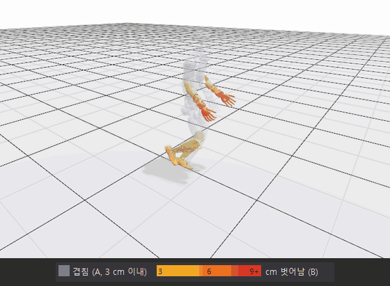

툴바의 **겹쳐 비교**(`O`)나 **비교** 탭에서 켭니다. 같은 동작을 다른 소스(BVH와 FBX, 보정 전후 등)로 만든 두 모션의 자세 차이를 한 자리에서 봅니다.

- 대상(B)의 골반을 기준(A)의 골반 위치로 옮기고, "골반 위치 + 방향"이면 향한 방향도 맞춥니다. 걸어간 경로 차이는 빠지고 자세 차이만 남습니다.
- A는 회색 반투명으로 그립니다. B는 A에서 허용 오차(기본 3 cm)보다 많이 벗어난 부위만 노랑(허용 오차) → 주황(2배) → 빨강(3배 이상)으로 칠합니다. 회색만 보이면 둘이 겹친 것입니다.
- A·B는 비교 탭에서 고르거나, 계층 패널 우클릭 "겹쳐 비교: 기준(A)으로 / 대상(B)으로"로 정합니다.

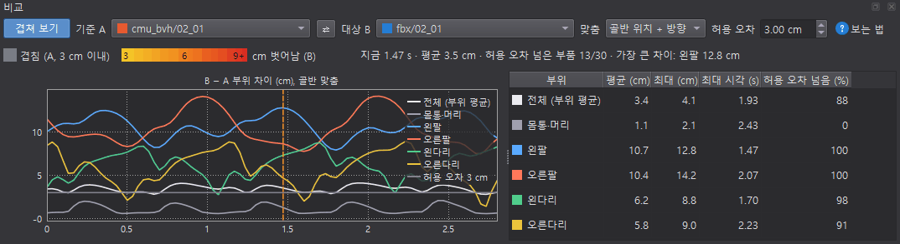

비교 탭에는 지금 프레임의 평균·가장 큰 차이, 시간에 따른 부위별 차이 그래프, 부위별 평균·최대·최대 시각·허용 오차를 넘은 비율 표가 나옵니다. 표의 행을 두 번 누르면 그 시각으로 갑니다.

## 물리 모드

툴바의 **물리 모드**(`P`)를 켜면 로봇을 관절각대로 그리지 않고 시뮬레이션한 결과로 그립니다. "로봇이 이 동작을 자기 발로 할 수 있는가"를 봅니다. 무엇이 로봇을 세워 두는지는 **균형 제어**로 고릅니다(툴바 선택 상자, 또는 물리 > 균형 제어).

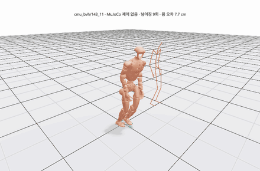 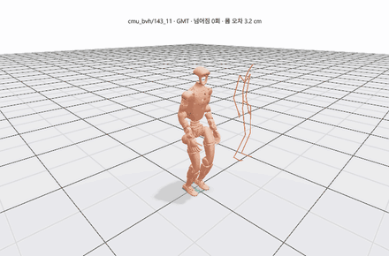

| 균형 제어 | 시뮬레이터 | 무엇이 균형을 잡나 | 11초 클립 |
|---|---|---|---|
| 보조 힘 (Isaac) | Isaac Sim (PhysX) | 골반을 원래 위치·자세로 당기는 가상 하네스. 힘이 클수록 로봇 혼자서는 어려운 동작 | 약 1분 30초 |
| 없음 (MuJoCo) | MuJoCo | 아무것도 없음. 관절각을 그대로 따라가기만 함(위 왼쪽: 넘어짐 9회) | 약 2초 |
| 추적 정책 (GMT) | MuJoCo | 공개된 G1 범용 추적 정책 GMT가 실제 로봇처럼 균형을 잡음(위 오른쪽: 넘어짐 0회) | 약 4초 |

- 모드마다 결과를 따로 두므로, 한 번 계산한 모드로 돌아가면 바로 나옵니다. 계산 진행률은 계층 패널, 인스펙터, 로봇 이름표, 상태바에 나옵니다.
- **넘어짐:** 원본 자세보다 60° 넘게 기울어짐, 골반 높이 0.3 m 미만(원본도 그만큼 낮은 구간은 제외), 원본보다 0.25 m 낮음 중 하나면 넘어진 것으로 보고(Isaac은 골반이 원본에서 0.5 m 벗어난 경우도), 그 시각의 원본 자세로 다시 시작해 셉니다. 넘어진 시각은 타임라인에 빨간 표시로, 이름표에 원인과 함께 나옵니다.

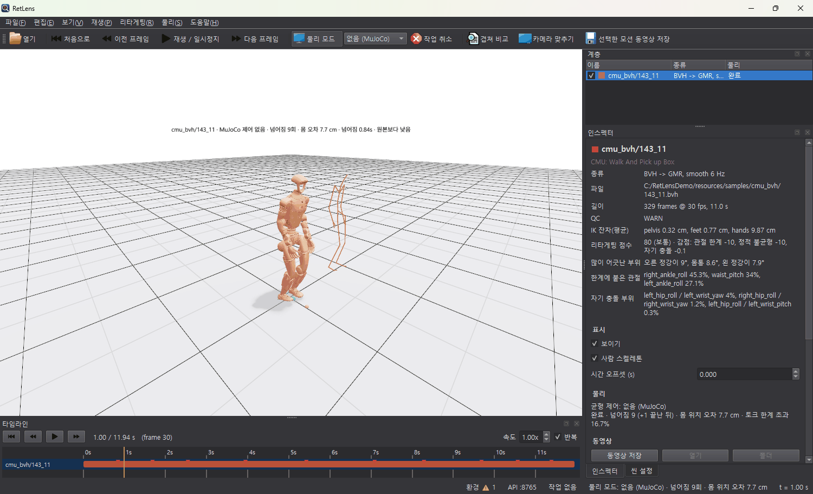

- **보조 힘 끄기:** "보조 힘 (Isaac)"의 가상 하네스는 **물리 > 골반 보조 힘 (Isaac)**에서 끌 수 있습니다. 끄면 PhysX로만 시뮬레이션하고, 분석 표의 재생 방식이 "물리 x0"으로 나옵니다.
- MuJoCo 모드는 클립이 끝난 뒤 마지막 자세로 1초 더 서 있게 하고, 그동안의 넘어짐은 "(+2 끝난 뒤)"처럼 따로 셉니다.
- 물리 모드에서는 분석 탭의 그래프·표도 시뮬레이션된 동작으로 잽니다.
- **작업 취소**는 대기 중이거나 도는 중인 물리 계산과 동영상 녹화를 멈춥니다.
- **Isaac:** 처음 계산할 때 NVIDIA Omniverse License Agreement(EULA) 동의 창이 한 번 뜹니다. 동의해야 돌아가고, 동의는 기억합니다. 로봇 모델은 NVIDIA 에셋 서버의 G1을 받아 씁니다(인터넷 필요). 오프라인이면 환경 설정 "로봇 USD"에 파일을 지정합니다.
- **GMT:** 정책 파일은 저자들이 연구 목적으로만 공개해 프로그램에 넣지 않았습니다. [설치 도우미](#설치-도우미)에서 연구용 라이선스에 동의하면 받습니다. PyTorch 없이 돌아갑니다.

## C3D 마커

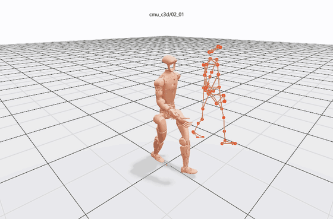

C3D 파일에는 마커 점만 있어서 바로 리타게팅할 수 없습니다. 그래서 RetLens는 같은 촬영의 솔버 결과(같은 이름의 BVH → FBX → AMASS 순, C3D와 같은 폴더와 기본 모션 폴더에서)를 찾아 그것을 리타게팅한 로봇을 쓰고, 사람 자리에 마커를 그립니다. 예제 C3D는 같은 이름의 BVH와 함께 들어 있습니다.

- 마커는 점으로, CMU 41마커 세트는 마커 사이 선으로도 그립니다. 허리 마커로 솔버 스켈레톤 좌표에 맞춰 그립니다.
- 인스펙터에 **마커 QC**가 나옵니다: 마커 수, 빠진 비율(많이 빠진 마커 3개), 가장 긴 공백, 튐(라벨 뒤바뀜이나 유령 점).
- 솔버 결과를 찾지 못하면 무엇을 같은 폴더에 두면 되는지 알려 줍니다.

## 동영상 저장

인스펙터의 **동영상 저장**이나 **선택한 모션 동영상 저장**(`Ctrl+E`)은 Isaac Sim에서 사람 스켈레톤과 로봇을 나란히 녹화해 MP4로 저장합니다(Isaac Sim 필요).

- 보이는 그 동작 그대로 녹화합니다. 물리 모드가 켜져 있으면 그 시뮬레이션 결과를 녹화합니다.
- 다 되면 인스펙터의 "열기"로 동영상 플레이어에서, "폴더"로 탐색기에서 엽니다. 기본 위치는 `문서\RetLens\videos`입니다.
- 파일 이름은 `모션_방식_xxxxxx.mp4`입니다. 끝의 여섯 글자는 녹화한 내용(모션, 리타게팅 보정, 물리 설정)을 나타내서, 같은 클립을 보정을 바꿔 녹화하면 따로 저장됩니다. 같은 내용을 다시 저장하면 이미 있는 파일을 씁니다.

## 환경 설정

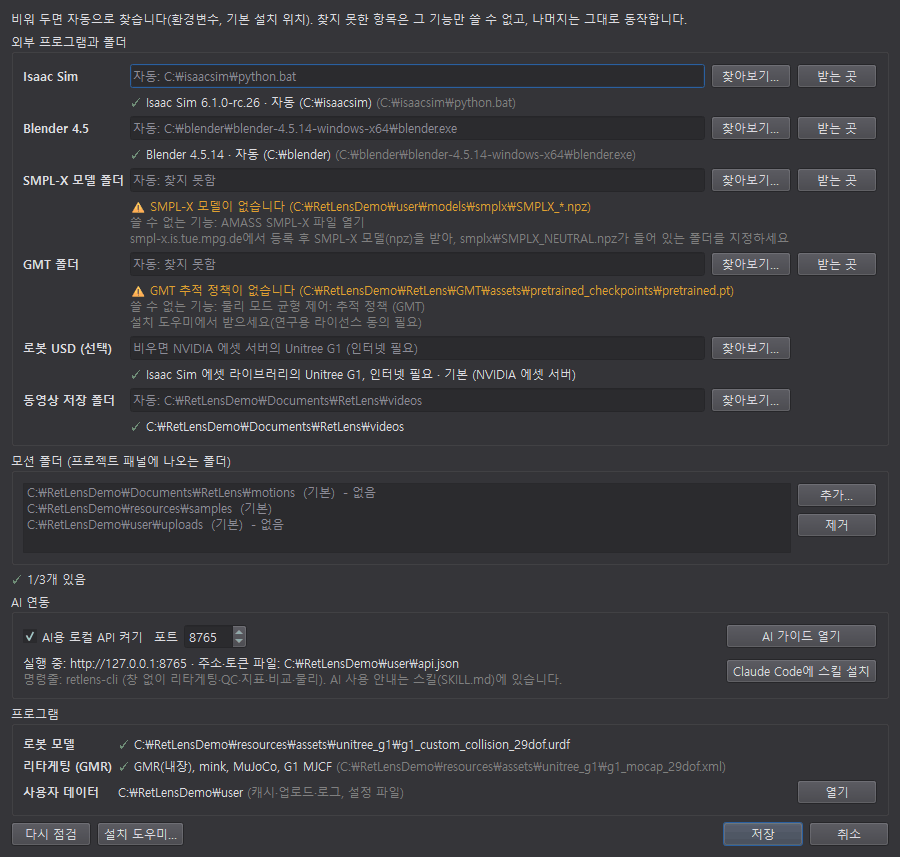

**파일 > 환경 설정**(`Ctrl+,`)에서 외부 프로그램과 폴더 위치를 정하고, 각 기능에 필요한 것이 있는지 바로 점검합니다. 상태바 오른쪽 "환경 ✓ / ⚠"를 눌러도 열립니다.

- 항목: Isaac Sim, Blender 4.5, SMPL-X 모델 폴더, GMT 폴더, 로봇 USD(선택), 동영상 저장 폴더, 모션 폴더(프로젝트 패널에 더할 폴더), AI 연동.
- 칸을 비워 두면 자동으로 찾고, 찾은 곳이 흐리게 나옵니다. 입력하는 동안 ✓/⚠와 "쓸 수 없는 기능", 고치는 방법이 바뀝니다. "받는 곳"은 내려받기 페이지를 엽니다.
- 빠진 것은 아래 **설치 도우미...** 버튼으로 받을 수 있습니다.

## 설치 도우미

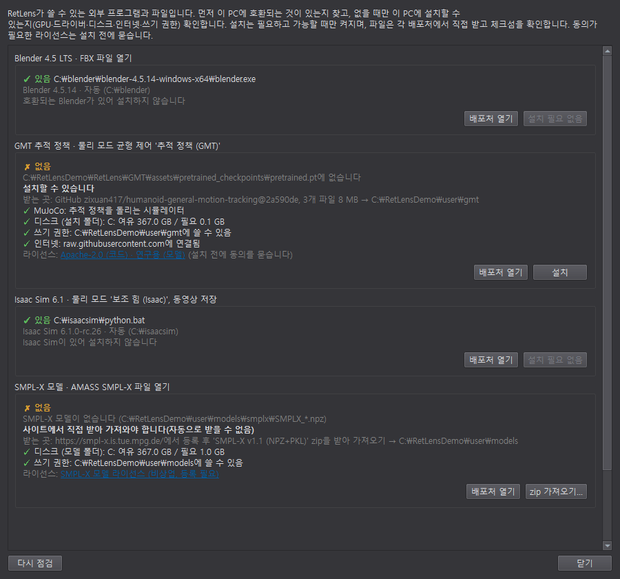

**파일 > 설치 도우미**는 RetLens가 쓸 수 있는 외부 프로그램과 파일을 이 PC 기준으로 점검하고, **필요하고 가능할 때만** 설치합니다.

1. **이미 있는지:** 먼저 호환되는 것을 찾습니다(환경 설정, 환경변수, 흔한 설치 위치). 있으면 아무것도 받지 않습니다. 설정이 옮겨진 폴더나 다른 버전을 가리키더라도 다른 곳에 호환되는 것이 있으면 받지 않고 설정만 바꿉니다("이것으로 설정").
2. **설치할 수 있는지:** 없을 때만 조건을 봅니다. Windows 64비트, 디스크 여유, 배포처 연결, 쓰기 권한, Isaac은 RTX GPU·VRAM·드라이버. 조건마다 ✓(됨), ✗(막힘), ⚠(주의)가 붙고, 막히면 이유가 나옵니다.
3. **설치:** "설치" 버튼은 필요하고 가능할 때만 켜집니다. 동의가 필요한 라이선스는 설치 전에 보여 주고 묻습니다.

| 구성 요소 | 쓰는 곳 | 받는 곳 · 크기 | 라이선스 |
|---|---|---|---|
| Blender 4.5 LTS | FBX 열기 | blender.org, 약 400 MB | GPL |
| GMT 추적 정책 | 물리 모드 "추적 정책 (GMT)" | 저자들의 GitHub, 약 8 MB | Apache-2.0, 모델은 연구용 (**동의 필요**) |
| Isaac Sim 6.1 | 물리 모드 "보조 힘 (Isaac)", 동영상 | NVIDIA, 약 10 GB (풀면 25 GB) | NVIDIA EULA (**동의 필요**) |
| SMPL-X 모델 | AMASS SMPL-X 열기 | smpl-x.is.tue.mpg.de (등록 필요) | 비상업 |

- 파일은 각 배포처에서 직접 받고, 배포처의 체크섬과 맞을 때만 씁니다. 받다 끊기면 다음에 이어 받습니다. 압축은 임시 폴더에 다 푼 뒤에 제자리로 옮겨, 반쯤 설치된 상태가 남지 않습니다.
- 이미 있는 폴더는 지우거나 덮어쓰지 않습니다. 예를 들어 `C:\isaacsim`에 다른 버전이 있으면 Isaac Sim 6.1은 `C:\isaacsim-6.1.0`에 따로 설치합니다.
- **SMPL-X**는 등록한 사람만 받을 수 있어 자동으로 받지 않습니다. "배포처 열기"로 등록하고 'SMPL-X v1.1 (NPZ+PKL)' zip을 받은 뒤, "zip 가져오기"로 그 zip을 고르면 필요한 파일만 꺼내 넣습니다.
- 설치 중에 창을 닫으면 "계속 설치(창만 닫기)"와 "설치 멈추기" 중에서 고릅니다. RetLens를 끄려 하면 먼저 묻습니다.

## AI·스크립트 연동

Claude 같은 AI 에이전트나 스크립트가 RetLens를 다루는 방법은 두 가지입니다.

- **`retlens-cli`** (프로그램 폴더의 `retlens-cli.exe`): 창 없이 돌고 결과를 JSON으로 냅니다. 숫자는 창과 같습니다.
  - `info`(환경 점검), `library`(모션 폴더), `inspect`(QC·지표·마커 QC), `metrics`(분석 표), `compare A B`(겹쳐 비교와 가장 다른 순간), `align`, `retarget`, `c3d-qc`, `physics`, `video`, `setup`(설치 도우미).
  - 모션을 여는 명령은 `--foot-flat`, `--swing-clearance CM`, `--self-collision`, `--smooth HZ`를 받습니다.
  - 설치 도우미로 GMT·Isaac을 받을 때는 사용자가 직접 동의한 경우에만 `--accept-license`를 줍니다.
- **로컬 HTTP API:** 떠 있는 창을 `http://127.0.0.1:8765`에서 조작합니다. 모션 열기, 재생·탐색, 겹쳐 비교, 물리 모드, 동영상, 카메라, 스크린샷, 지표를 다룹니다.
  - 이 PC(127.0.0.1)에서만 받고, 실행할 때마다 바뀌는 토큰이 필요합니다. 웹 페이지에서 보낸 요청은 거부합니다.
  - 주소와 토큰은 사용자 데이터 폴더의 `api.json`에 있습니다(`retlens-cli api`). 환경 설정 "AI 연동"에서 끄거나 포트를 바꿉니다.
- **Claude Code 스킬:** 환경 설정의 "Claude Code에 스킬 설치"(또는 `retlens-cli install-skill`)를 누르면 위 두 방법의 사용법과 지표 해석이 `~/.claude/skills/retlens`에 들어가, Claude Code가 RetLens를 다룰 수 있게 됩니다.

## 파일 위치

| 무엇 | 어디 |
|---|---|
| 설정, 캐시(리타겟·물리), 로그, `api.json`, 설치 도우미가 받은 Blender·GMT | `%LOCALAPPDATA%\RetLens` (**파일 > 데이터 폴더 열기**) |
| 동영상 | `문서\RetLens\videos` |
| 내 모션 폴더 (프로젝트 패널) | `문서\RetLens\motions` |
| 예제, 사용 설명서, 라이선스 고지 | 프로그램 폴더의 `_internal` |

정확한 경로는 **도움말 > 정보**에 나옵니다.

## 문제 해결

| 증상 | 할 일 |
|---|---|
| FBX·SMPL-X 파일이 안 열림 | 설치 도우미에서 Blender 4.5 / SMPL-X 모델을 설치하거나 환경 설정에서 지정 |
| 균형 제어에 "(설치 필요)"가 붙음 | 고르면 이유가 나오고 설치 도우미를 열 수 있습니다 |
| 물리 계산이 "Isaac Sim EULA에 동의하지 않은 상태입니다"로 실패 | 물리 모드를 켜고 동의 창에서 동의 |
| 처음 여는 사람 모션이 오래 걸림 | 리타게팅 중입니다(수십 초). 다음부터는 저장된 결과로 바로 열립니다 |
| C3D를 열면 솔버 결과가 없다고 나옴 | 같은 촬영의 BVH·FBX·AMASS 파일을 C3D와 같은 폴더에 같은 이름으로 둡니다 |
| 창 배치가 엉킴 | 보기 > 레이아웃 초기화 |
| 3D 화면이 하얗게 비어 있음 | 그래픽 드라이버를 업데이트하고, **보기 > 브라우저에서 씬 열기**로 같은 장면이 보이는지 확인 |
